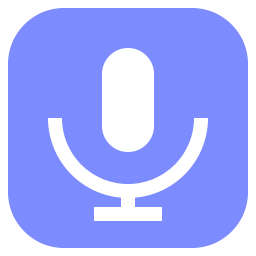

<p align="center"></p>

<h1 align="center">bettermic</h1>

<p align="center">A clean, simple microphone processor for Windows.</p>

## Features

- **Noise suppression**: removes steady background noise like fans and hum
- **Echo cancellation**: stops your speakers bleeding into the mic
- **Auto gain**: keeps your voice at a steady volume
- **Voice gate**: stays silent until you speak; drag across the level meter to set the threshold
- **Compressor + limiter**: evens out loud and quiet moments without clipping
- **Device routing**: pick any input and output device
- **Recording**: save the processed audio as `.webm`

Settings are remembered between launches.

## Download

Grab `bettermic.exe` from the [latest release](https://github.com/Thauyel/bettermic/releases/latest) and run it. It's portable, so there's nothing to install.

> The exe isn't code-signed yet, so Windows SmartScreen may warn you on first launch. Click **More info → Run anyway**.

## Use it as a mic in other apps

Windows doesn't let an app create a microphone on its own, so route the processed audio through a virtual audio cable:

1. Install a virtual cable such as [VB-CABLE](https://vb-audio.com/Cable/).
2. In bettermic, set **Output** to `CABLE Input` and turn on **Listen**.
3. In your other app, choose `CABLE Output` as the microphone.

To hear yourself instead, set **Output** to your headphones. Use headphones, not speakers, or you'll get feedback.

## How it works

```
mic → noise suppression / echo cancellation / auto gain
    → high-pass (80 Hz) → voice gate → compressor → volume → limiter → output
```

The first stage is Chromium's built-in WebRTC audio processing. The rest is Web Audio, plus a small AudioWorklet for the gate ([gate-worklet.js](gate-worklet.js)). It's packaged with Electron.

## Build from source

Requires Node.js 20+.

```bash
npm install
npm test        # gate self-check
npm start       # run in development
npm run dist    # build dist/bettermic.exe
```

If `npm start` reports *"Electron failed to install correctly"*:

- npm 11 blocks install scripts by default. Run `npm approve-scripts electron`, then `npm rebuild electron`.
- On Node 26, Electron's unzip can stop partway, leaving only `locales/` in `node_modules/electron/dist`. Unzip the downloaded `electron-v*-win32-x64.zip` from `%LOCALAPPDATA%\electron\Cache` into that folder yourself. Then create `node_modules/electron/path.txt` containing `electron.exe`.
